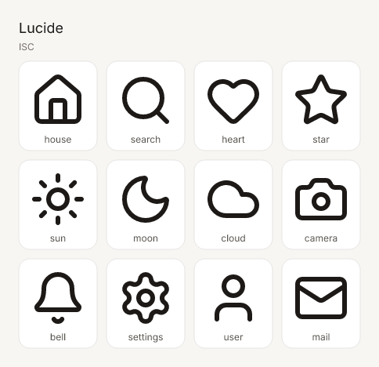

# icones-mcp

MCP server for [Icônes](https://icones.js.org), Anthony Fu's icon explorer. It searches the [Iconify](https://iconify.design) catalog behind Icônes, returns each collection's license, and sends PNG previews back as MCP image content so a model can see the icons.



## Tools

| Tool | What you get |
| --- | --- |
| `list_collections` | Filter the catalog by name, prefix, or category. Each hit includes author, license, icon count, and sample ids. |
| `get_collection` | One collection: license, categories, a page of icon names, and a PNG of its sample icons. |
| `search_icons` | Keyword search (`query`, optional `prefix` / `prefixes` / `category`, `limit`, `start`). Results include Iconify ids, licenses, and Icônes links, plus a contact-sheet PNG. |
| `get_icon` | One icon (`prefix:name`): SVG, dimensions, collection, license, alias parent, Icônes URL, and a PNG. Snippets cover SVG, data URL, Vue, React, Svelte, UnoCSS, Tailwind, and the Iconify name. |
| `preview_icons` | One labeled contact sheet for a list of ids, or for the top search matches. `size`, `color`, `background`, and `columns` are configurable. |

`search_icons` and `get_collection` include a preview image by default. Pass `preview: false` when you only want the JSON.

Iconify search matches names and keywords. It does not search by visual similarity. Use the contact sheet to compare candidates.

### Code snippets

`get_icon` returns the formats Icônes offers:

- **Iconify name:** `lucide:house`
- **SVG** and a **data URL**
- **Iconify SVG URL:** `https://api.iconify.design/lucide/house.svg`
- **Vue, React, and Svelte** components
- **UnoCSS:** `<div class="i-lucide-house"></div>`
- **Tailwind** (Iconify plugin): `<span class="icon-[lucide--house]"></span>`

Snippet SVGs keep `currentColor` so they inherit text color. Pass `color` (for example `#b45309`) when the SVG and the PNG should use a fixed color. PNGs default to `#1c1917` on white. Palette icons that do not use `currentColor` keep their original colors.

### Resources

| URI | Body |
| --- | --- |
| `icones://collections` | Collection list with licenses |
| `icones://collection/{prefix}` | One collection, including up to 200 icon names |
| `icones://icon/{prefix}/{name}.svg` | SVG |
| `icones://icon/{prefix}/{name}.png` | 128px PNG on white |
| `icones://icon/{prefix}/{name}.json` | Metadata and snippets |

Icônes links look like `https://icones.js.org/collection/lucide?icon=lucide:house`.

## Setup

Requires Node.js 20 or newer.

```bash
npx -y icones-mcp
```

The published package's `bin` entry is `icones-mcp`. Stdio is the default. Logs go to stderr so they stay off the JSON-RPC stream.

### Cursor

Add this to `~/.cursor/mcp.json` or the project's `.cursor/mcp.json`:

```json
{
  "mcpServers": {
    "icones": {
      "command": "npx",
      "args": ["-y", "icones-mcp"]
    }
  }
}
```

### Claude Desktop

The same `mcpServers` block goes in the desktop config:

- macOS: `~/Library/Application Support/Claude/claude_desktop_config.json`
- Windows: `%APPDATA%\Claude\claude_desktop_config.json`
- Linux: `~/.config/Claude/claude_desktop_config.json`

Restart Claude Desktop after saving.

### Claude Code

```bash
claude mcp add icones -- npx -y icones-mcp
```

### VS Code

Create `.vscode/mcp.json`:

```json
{
  "servers": {
    "icones": {
      "type": "stdio",
      "command": "npx",
      "args": ["-y", "icones-mcp"]
    }
  }
}
```

### Streamable HTTP

HTTP mode is stateless and has no authentication. Bind it to localhost.

```bash
npx icones-mcp --http --port 3333
```

The MCP endpoint is `http://127.0.0.1:3333/mcp`. A client config looks like:

```json
{
  "mcpServers": {
    "icones": {
      "url": "http://127.0.0.1:3333/mcp"
    }
  }
}
```

`GET /health` returns `ok`.

### MCP Inspector

The web UI:

```bash
npm install
npm run build
npx @modelcontextprotocol/inspector node dist/cli.js
```

A non-interactive check of the stdio server:

```bash
npx @modelcontextprotocol/inspector --cli --method tools/list node dist/cli.js
npx @modelcontextprotocol/inspector --cli --method tools/call \
  --tool-name get_icon \
  --tool-args-json '{"icon":"lucide:house","size":64}' \
  node dist/cli.js
```

## Examples

Search and look at the sheet:

```json
{
  "name": "search_icons",
  "arguments": { "query": "arrow", "prefix": "lucide", "limit": 8 }
}
```

Fetch one icon as a React component and a 128px PNG:

```json
{
  "name": "get_icon",
  "arguments": { "icon": "lucide:house", "formats": ["react", "svg", "iconify"] }
}
```

Compare a hand-picked set. This is the call that produced the image at the top of the README:

```json
{
  "name": "preview_icons",
  "arguments": {
    "title": "Lucide",
    "columns": 4,
    "size": 72,
    "icons": [
      "lucide:house", "lucide:search", "lucide:heart", "lucide:star",
      "lucide:sun", "lucide:moon", "lucide:cloud", "lucide:camera",
      "lucide:bell", "lucide:settings", "lucide:user", "lucide:mail"
    ]
  }
}
```

Prompts that work well once the server is connected:

- "Search Lucide for a house icon and show me the candidates."
- "Get the SVG and a Svelte component for `tabler:brand-github`."
- "Make a contact sheet of weather icons from Phosphor."

## Licenses

This server is MIT. See [LICENSE](LICENSE).

Icon artwork is not relicensed. Every collection on Iconify has its own license (MIT, Apache-2.0, ISC, CC BY 4.0, and others). `list_collections`, `get_collection`, `search_icons`, `get_icon`, and `preview_icons` return that license's title, SPDX id, and URL. SVG snippets include a comment with the collection, author, and license. Read that license before shipping an icon.

Contact-sheet labels are set in [Inter](https://github.com/rsms/inter), which is bundled under the SIL Open Font License. The license text is in [assets/fonts/OFL.txt](assets/fonts/OFL.txt). Rasterized labels in a PNG are pixels. The font file itself stays under the OFL.

## Data source

Icônes is a front end over Iconify. This server uses the public API at `https://api.iconify.design`:

- `GET /collections` and `GET /collection`
- `GET /search`
- `GET /{prefix}.json?icons=...`

SVGs are built locally with `@iconify/utils` and rasterized with `@resvg/resvg-js`. The client keeps at least 100ms between requests, caches collection metadata, search results, and icon bodies in memory, and retries 429 and 5xx responses.

The public API is a shared service. Point `ICONIFY_API_URL` at your own [Iconify API](https://iconify.design/docs/api/) instance if you need higher volume.

| Variable | Default | Purpose |
| --- | --- | --- |
| `ICONIFY_API_URL` | `https://api.iconify.design` | API origin |
| `ICONES_MIN_INTERVAL_MS` | `100` | Minimum gap between API calls |
| `ICONES_CACHE` | enabled | Set to `0` to disable the memory cache |

## Development

```bash
npm install
npm test
npm run typecheck
npm run build
node dist/cli.js --help
npm run smoke
```

`npm test` includes rendering tests and a live call against the public API. `npm run smoke` starts the built stdio server, calls `preview_icons`, and writes `docs/contact-sheet.png`.

```bash
npm publish
```

`prepublishOnly` compiles TypeScript into `dist/` before the package is packed.
